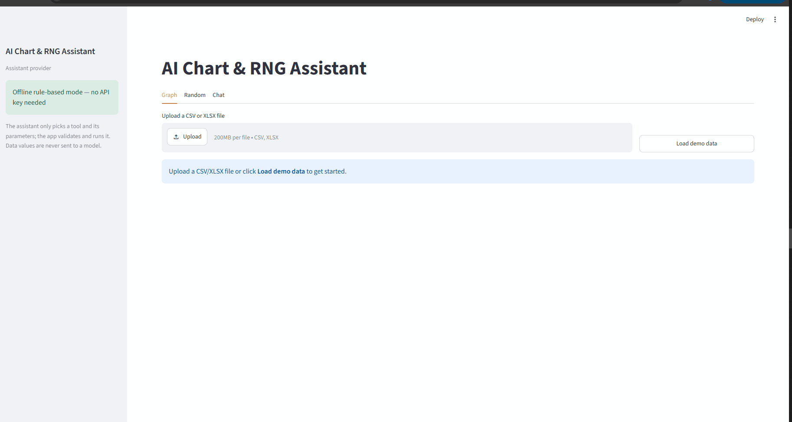
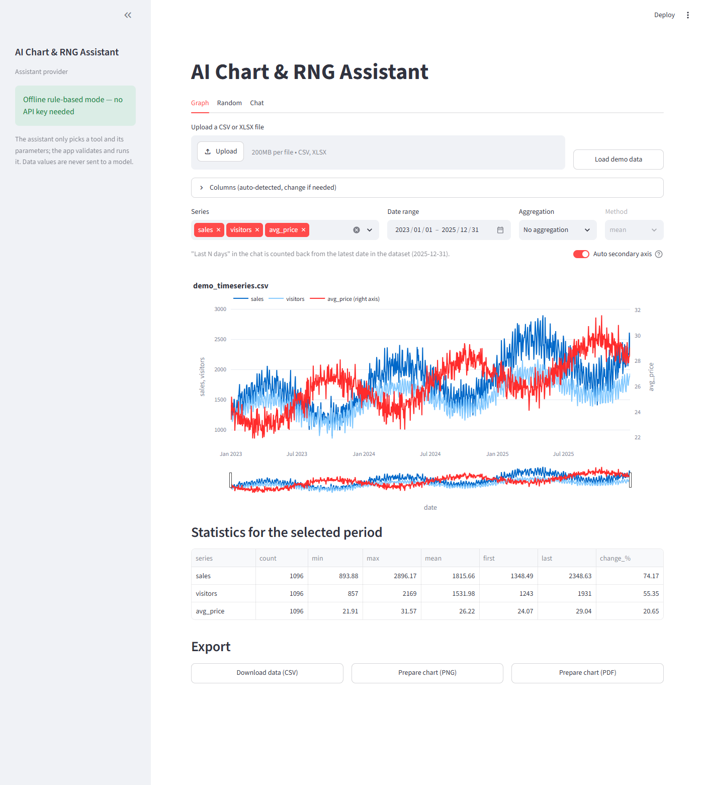
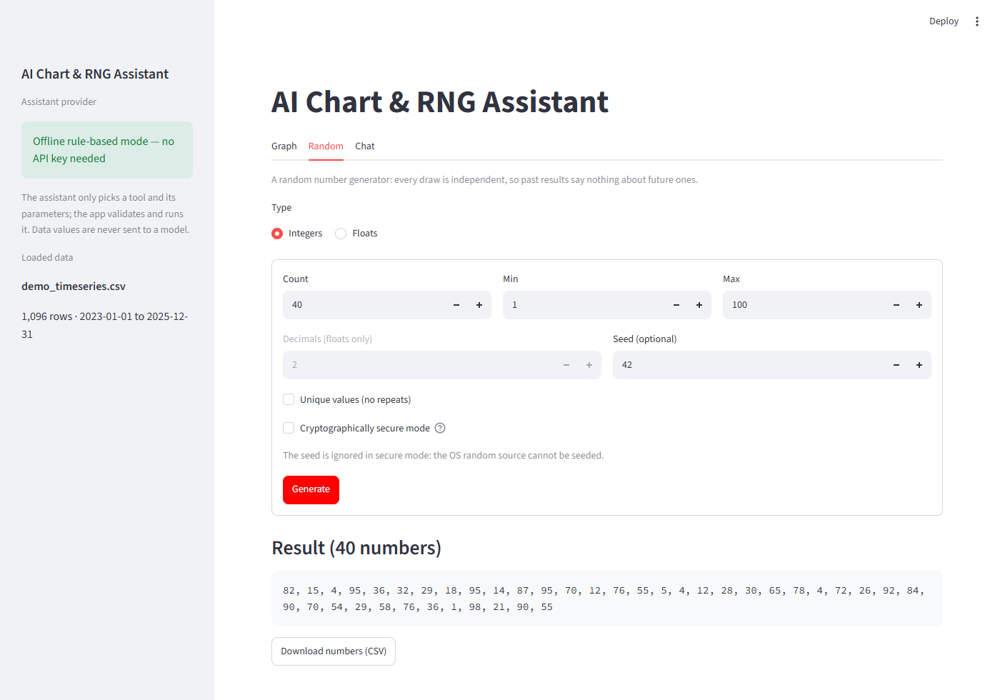
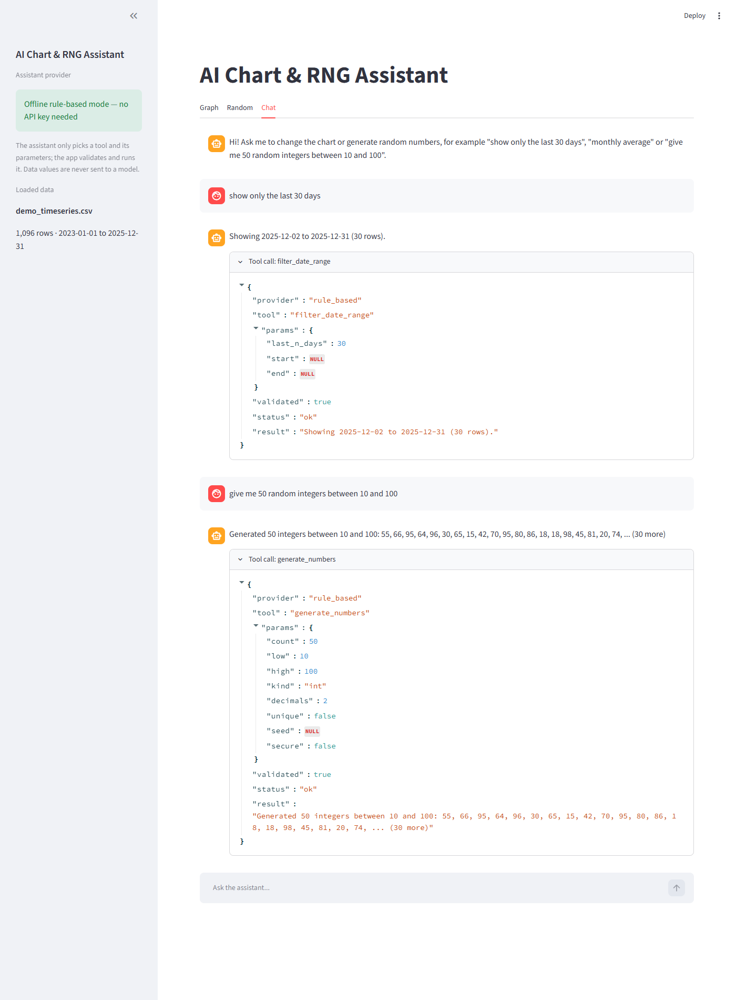
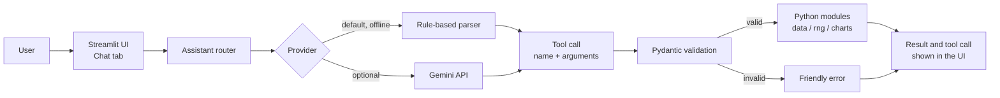

# AI Chart & RNG Assistant

Interactive time series charts, a random number generator and a chat assistant that drives both by calling validated Python tools. Runs fully offline; an LLM is optional.

[](https://github.com/folivia00/AI-Chart-RNG-Assistant/actions/workflows/ci.yml)

[](LICENSE)



| Graph | Random | Chat |
|---|---|---|
| [](docs/img/graph.png) | [](docs/img/random.png) | [](docs/img/chat.png) |

## Features

**Historical graph**
- Upload a CSV or XLSX file, or load the bundled synthetic demo data (3 years of daily values).
- Date and numeric columns are detected automatically and can be changed manually. CSV files may be UTF-8 (with or without BOM), cp1252 or latin-1, separated by commas, semicolons, tabs or pipes.
- Interactive Plotly chart with multiple series, hover, zoom and a range slider; date range filter; daily, weekly or monthly aggregation (mean, sum, min, max).
- Automatic secondary y-axis: a series more than 10× smaller than the largest one (by median absolute value of the plotted data) moves to a right-hand axis, marked "(right axis)" in the legend, so it does not sit flat at zero. It can be switched off with the **Auto secondary axis** toggle.
- Statistics for the selected period: count, min, max, mean, first, last and % change.
- Export the shown data as CSV and the chart as PNG or PDF. Images are rendered only on request, one at a time per session, and need Chrome or Chromium; without it, the rest of the app keeps working.

**Random number generator**
- Up to 1,000,000 integers or floats (0–6 decimals) in an inclusive range.
- Unique values, a seed for reproducible results, and a cryptographically secure mode that uses the operating system's random source.
- Copy-friendly output and CSV download. It is a generator: every draw is independent.

**AI chat**
- Plain-English requests become calls to 6 tools: `filter_date_range`, `select_series`, `aggregate`, `summarize`, `generate_numbers` and `export`.
- Offline rule-based parser by default; optional Gemini provider with automatic offline fallback.
- Every assistant turn shows the tool call: tool name, validated parameters and result. Chat actions update the Graph and Random tabs.

## How the assistant works

The language model never touches the data. It only chooses a tool and its parameters; the app validates those parameters with pydantic and runs the tool in plain Python, so a wrong guess becomes a friendly error instead of a wrong answer. The model sees the user's message, a short chat history and a compact description of the app state (column names, date range, current settings), never the data values. Tool schemas for the model are generated from the same pydantic models that validate the calls, and every call is visible in the UI.



## Quick start

Requires Python 3.11 or newer. Works without any API key and without a `.env` file.

```bash
git clone https://github.com/folivia00/AI-Chart-RNG-Assistant.git
cd AI-Chart-RNG-Assistant
python -m venv .venv
source .venv/bin/activate        # Windows: .venv\Scripts\activate
pip install -r requirements.txt
streamlit run app/main.py
```

Open http://localhost:8501 and click **Load demo data**. PNG/PDF export uses Kaleido, which needs Google Chrome or Chromium installed on the same machine; CSV export and the interactive chart work without it.

## Using Gemini (optional)

1. Create an API key in [Google AI Studio](https://aistudio.google.com/apikey).
2. Copy the example settings and fill them in:

   ```bash
   cp .env.example .env
   ```

   ```ini
   LLM_PROVIDER=gemini
   GEMINI_API_KEY=<your key>
   GEMINI_MODEL=            # optional, defaults to gemini-3.5-flash
   ```

3. Restart the app. The sidebar shows the active provider and model.

The free tier has per-project limits on requests per minute and per day ([rate limits](https://ai.google.dev/gemini-api/docs/rate-limits)). When Gemini is unavailable (rate limit or quota, invalid key, network error, service outage), that message is answered by the offline parser and the chat shows a notice. Without a key the app starts in offline mode. The key is read from `.env`, which is git-ignored, and is never logged.

## Example chat phrases

All of these work in offline mode (Gemini understands looser wording too):

| Goal | Try |
|---|---|
| Date range | `show only the last 30 days` · `last 2 weeks` · `from 2024-01-01 to 2024-06-30` · `since 2024-03-01` |
| Series | `show sales and visitors` · `plot avg price` |
| Aggregation | `monthly average` · `weekly sum` · `max per day` |
| Statistics | `summarize` · `stats for last 90 days` |
| Random numbers | `give me 50 random integers between 10 and 100` · `10 unique numbers from 1 to 20` · `5 random floats between 0 and 1 with 3 decimals` · `3 secure random integers from 1 to 1000` · `seed 42` |
| Export | `export chart as png` · `save the chart as PDF` · `download the data as csv` · `export numbers as csv` |

"Last N days" is counted back from the latest date in the data, not from today. `seed 42` on its own repeats the previous generation with that seed.

## Project structure

```
app/
├── main.py              Streamlit entry point: tabs, sidebar, shared state
├── state.py             app state shared by the UI and the tools
├── config.py            settings from environment / .env
├── ui/                  Graph, Random and Chat tabs (UI only)
├── data/                loading, column detection, filtering, aggregation, statistics
├── charts/              Plotly figures, cached PNG/PDF export
├── rng/                 random number generator
└── assistant/
    ├── tools.py         tool registry: pydantic models + executors
    ├── router.py        message -> provider -> validation -> execution
    └── providers/       rule-based parser, Gemini, schema converter
data/demo_timeseries.csv synthetic demo data
scripts/                 demo data generator
tests/                   pytest suite
```

## Running tests

```bash
pip install -r requirements-dev.txt
pytest -q
ruff check .
ruff format --check .
```

The tests cover data loading (CSV encodings and separators, column detection, friendly errors), filtering, aggregation and statistics; the secondary-axis rule; the random number generator and its limits; tool parameter validation and execution; the offline parser's phrases; chat actions updating the shared app state; the Gemini provider, its schema conversion and the offline fallback; image export caching, retries, timeouts and render limits; and Streamlit UI tests of the export buttons and the Random tab form. They need no network, no API key and no Chrome: the Gemini client and image rendering are mocked. CI runs them on Python 3.11, 3.12, 3.13 and 3.14.

To regenerate the demo data: `python scripts/make_demo_data.py`.

## Roadmap

- OpenAI provider (planned)
- Ollama provider for local models (planned)

## License

[MIT](LICENSE)

## Contact

**Vladimir K**, Python developer.

- Upwork: https://www.upwork.com/freelancers/~01944470ea8eacd678
- Freelancer: https://www.freelancer.com/u/sngmu
